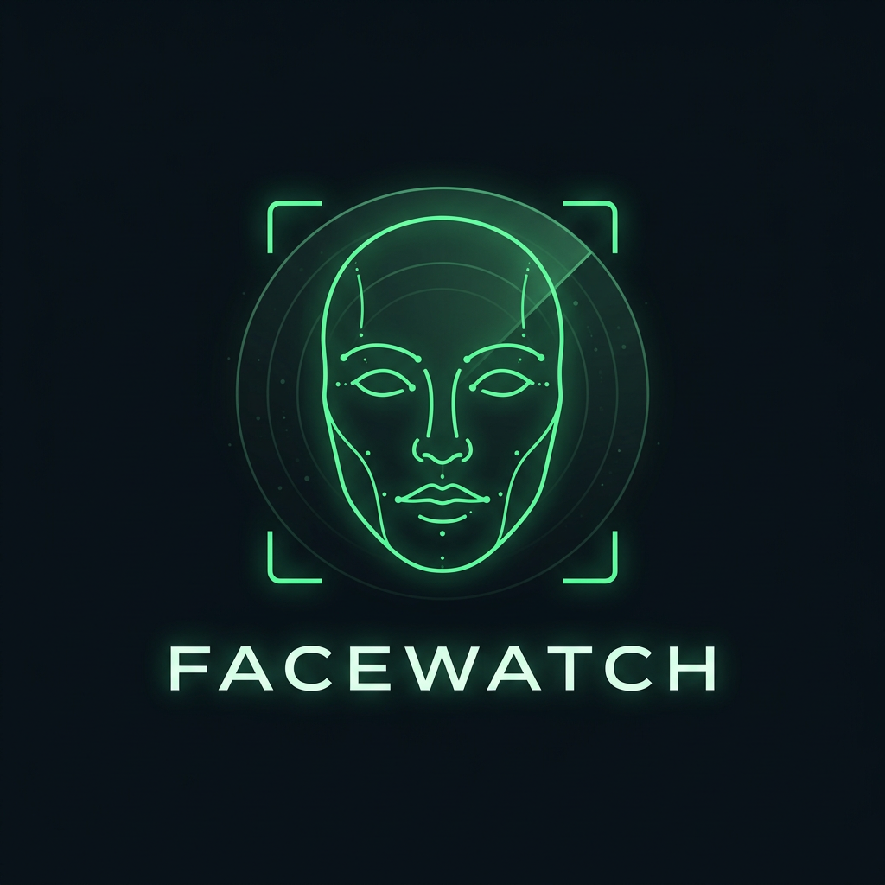
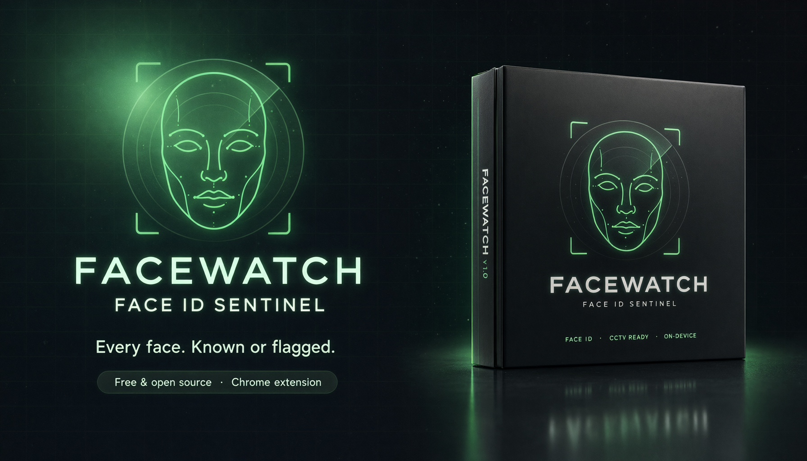
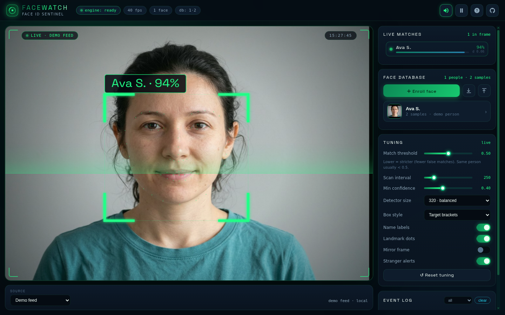
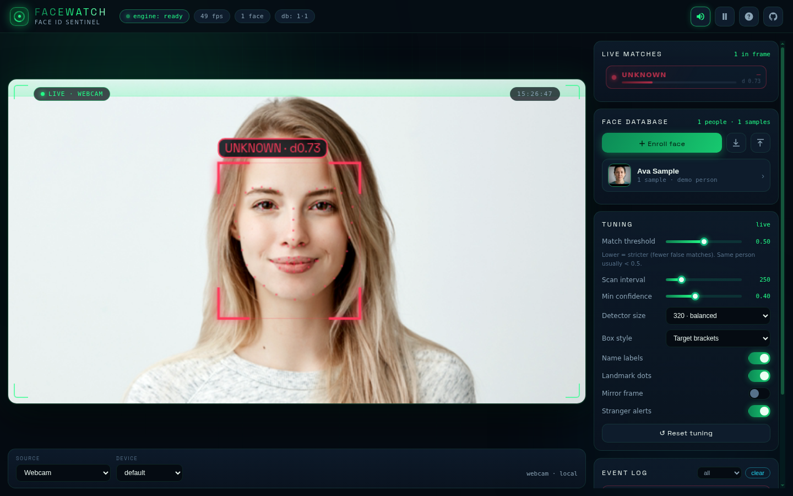
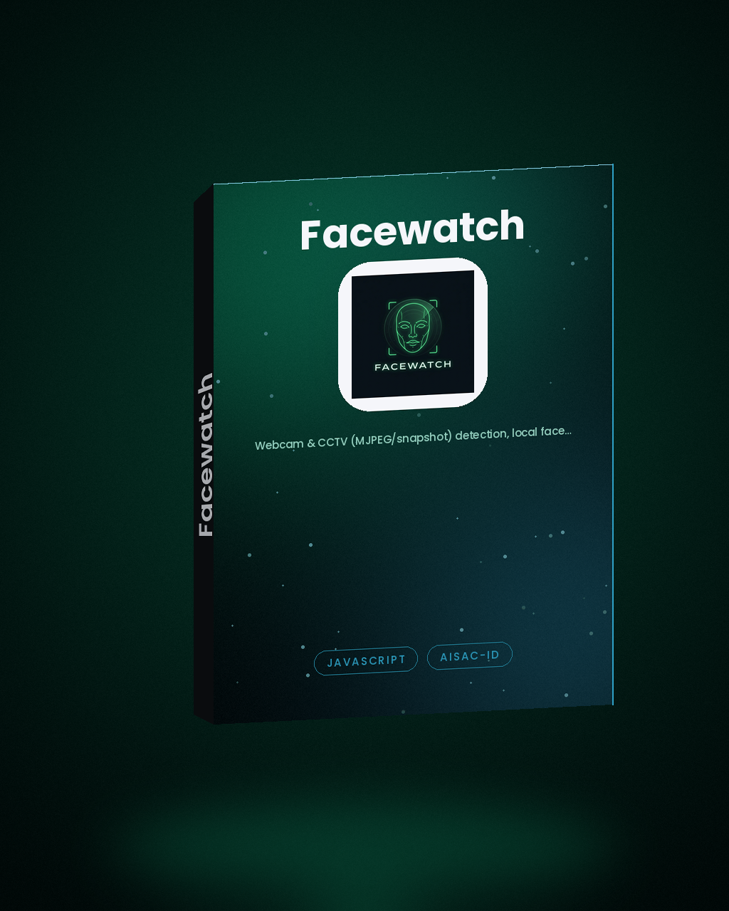
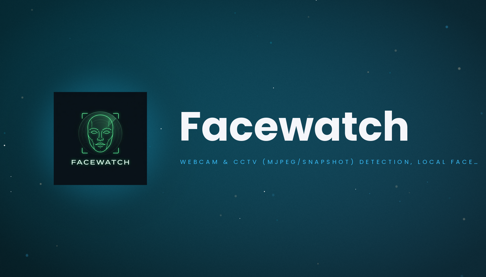
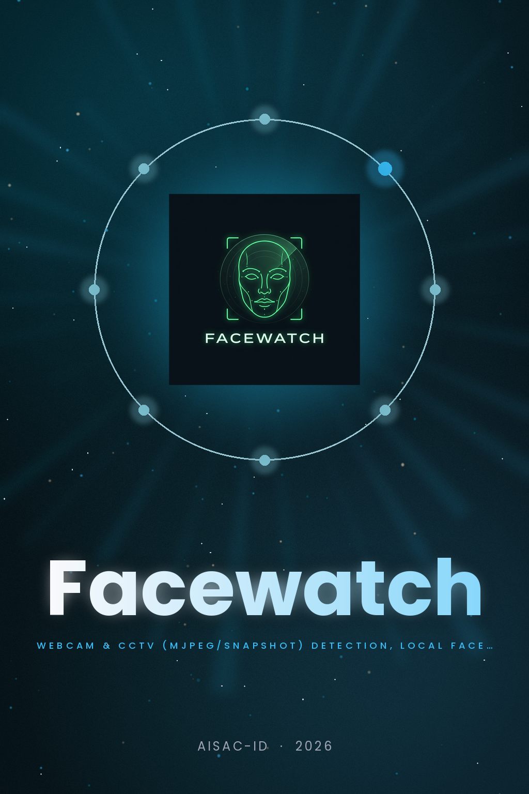
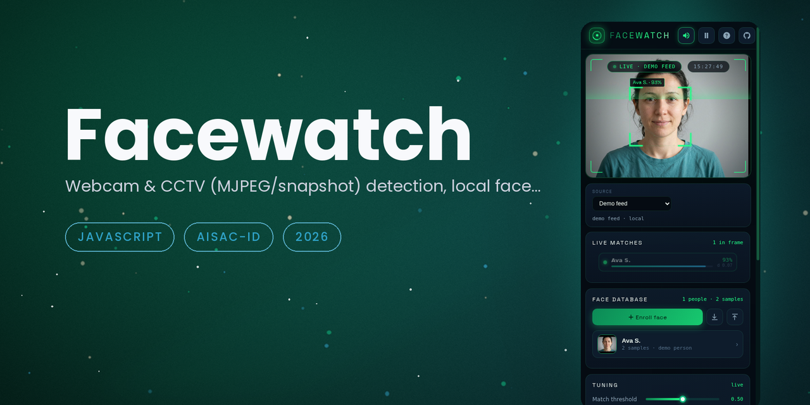
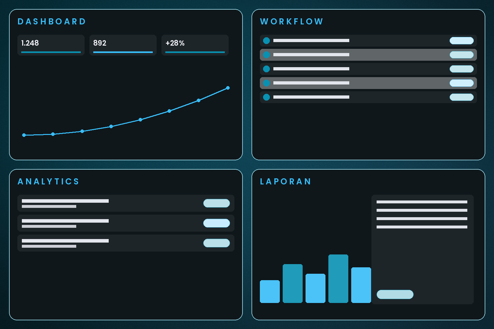
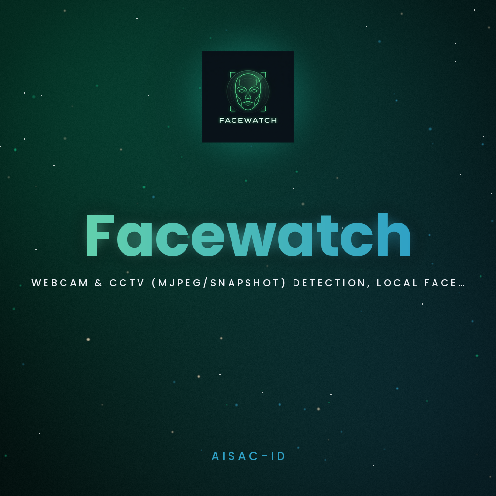

<div align="center">



# FaceWatch — Face ID Sentinel

<p align="center">
  
</p>


</div>



Open-source Chrome extension (Manifest V3) that runs **real-time face detection + recognition** on your webcam, a demo feed, or a **CCTV camera stream** — entirely on-device. Enroll faces into a local database, and FaceWatch labels every face it sees with a name and confidence, or flags it as **UNKNOWN** with an alert.

No cloud. No uploads. Everything (models, database, video) stays in your browser.



## Features

- **Live face recognition** — TinyFaceDetector + 68-point landmarks + 128-float recognition descriptors via a bundled [face-api.js](https://github.com/justadudewhohacks/face-api.js) (TensorFlow.js), WebGL-accelerated with CPU fallback.
- **Three video sources**
  - **Demo feed** — bundled fictional subject with CCTV-style noise, so it works instantly with zero setup.
  - **Webcam** — any camera device, pickable from a dropdown.
  - **CCTV** — MJPEG streams or JPEG snapshot URLs, with optional Basic-auth username/password. Frames are fetched by the extension (host permissions) and decoded locally, so no CORS problems.
- **Face database** — enroll from the live feed or upload photos, multiple samples per person, rename, add/remove samples, delete with undo, export/import as JSON.
- **Live match panel** — name, similarity %, distance, and thumbnail for every face currently in view.
- **Tuning deck** — match threshold, scan interval, min confidence, detector input size, box style (brackets / solid / minimal), labels, landmarks, mirror, unknown alerts.
- **Unknown alerts** — red box, screen flash, and beep when an unenrolled face appears (with cooldown so it doesn't spam).
- **Event log** — identity changes and unknown sightings, filterable, capped at 100 entries.
- **Radar-style HUD** — target brackets, landmark dots, scanline, live clock, FPS counter, pause overlay.
- Keyboard shortcuts: `Space` pause · `E` enroll · `M` mirror · `S` sound · `?` help.

## Install (unpacked)

1. Download this repo (Code → Download ZIP) or `git clone https://github.com/aisac-id/facewatch.git`.
2. Open `chrome://extensions`, enable **Developer mode**.
3. Click **Load unpacked** and select the `facewatch` folder.
4. Click the FaceWatch toolbar icon — the dashboard opens in a tab and the demo feed starts recognizing immediately.

## Connecting a CCTV camera

Pick **CCTV — MJPEG stream** or **CCTV — JPEG snapshot** in the source bar and paste the camera URL.

| Camera / software | Typical URL |
|---|---|
| Generic IP cam (MJPEG) | `http://192.168.1.50:8080/video` |
| D-Link | `http://<ip>/video.cgi` or `http://<ip>/mjpeg.cgi` |
| Axis | `http://<ip>/axis-cgi/mjpg/video.cgi` |
| Hikvision (snapshot) | `http://<ip>/ISAPI/Streaming/channels/101/picture` |
| Dahua (snapshot) | `http://<ip>/cgi-bin/snapshot.cgi` |
| ESP32-CAM | `http://<ip>:81/stream` |
| Android IP Webcam app | `http://<phone-ip>:8080/video` |
| go2rtc | `http://<host>:1984/api/stream.mjpeg?src=cam1` |

- If the camera needs a login, fill the **user / pass** fields (HTTP Basic auth).
- **RTSP** (`rtsp://…`) cannot be played by a browser directly. Put a gateway in front of it — e.g. [go2rtc](https://github.com/AlexxIT/go2rtc) or `ffmpeg` — that re-exposes the stream as MJPEG/HTTP, then point FaceWatch at that URL. This is documented in the in-app help (`?`).
- Snapshot mode polls a single JPEG at your chosen interval — perfect for cameras that only offer stills.

## How to add faces to the database

1. Get the person in view (webcam / CCTV), or prepare a clear photo of them.
2. Press **Enroll face** (or `E`):
   - The largest detected face is captured as a thumbnail + descriptor.
   - Choose **New person**, type a name (and optional note), then **Save**.
   - Or pick an existing person to **add another sample** to them.
3. You can also open a person's card and **upload photos** — each photo is detected, cropped, and stored as an extra sample. No face in the photo? It's rejected with a message.
4. More samples = more robust recognition (different angles, lighting, expressions). Each person can hold many samples.
5. **Export JSON** backs up the whole database; **Import JSON** restores it and merges people by name.

Everything is stored in `chrome.storage.local` on your machine — nothing ever leaves the browser.

## How the matching works

1. For every detected face, the recognition net computes a **descriptor: 128 numbers** that act like a fingerprint of the face (pose/lighting tolerant, identity-specific).
2. That fingerprint is compared to **every sample of every person** in your database using **euclidean distance**:

   `d = sqrt( Σ (a[i] − b[i])² )` for i = 1…128

3. A person's score is the **minimum distance across their samples**. The smallest score wins.
4. If that best distance is **below the threshold (default 0.50)** → the face is labeled with the person's name and a similarity of `(1 − d) × 100 %`. Otherwise → **UNKNOWN** + alert.

Rules of thumb: same person typically `d ≈ 0.25–0.45`, different people `d > 0.6`. Raise the threshold to be more lenient (fewer UNKNOWNs, more false matches); lower it to be stricter. The slider re-evaluates faces already on screen instantly, so you can feel the difference live.

## Privacy

- All inference runs locally (bundled models, ~6.5 MB). No network calls except the camera URL **you** configure.
- The database lives in `chrome.storage.local`; export/import is manual and file-based.
- The bundled demo subject (`assets/sample-face.jpg`) is an **AI-generated fictional person**, not a real individual.
- Use face recognition responsibly and only with the consent of the people you enroll; check your local laws before monitoring shared or public spaces.

## Tech notes

- Manifest V3, no build step, no external CDNs. face-api.js bundles TensorFlow.js 1.x and is MV3-CSP clean (no `eval` / `new Function`).
- MJPEG parsing scans the multipart byte stream for JPEG SOI/EOI markers (`FFD8`/`FFD9`) → `Blob` → `createImageBitmap`, so camera streams work without CORS headers.
- Face tracks are associated frame-to-frame by box-center distance, smoothed with lerp, and pruned after 900 ms; identity changes are logged once, not per frame.
- Detection runs on a `setTimeout` scheduler with a busy flag so the UI never blocks; drawing runs on `requestAnimationFrame`.

## Layout

```
facewatch/
├── manifest.json        MV3 manifest
├── background.js        toolbar icon → dashboard tab
├── app.html             dashboard UI
├── css/                 styles + bundled font
├── js/
│   ├── app.js           UI wiring, tracks, HUD, scan loop
│   ├── engine.js        model loading, detection, matching
│   ├── sources.js       demo / webcam / MJPEG / snapshot
│   ├── db.js            person database + export/import
│   └── audio.js         UI/alert sounds
├── vendor/              face-api.js + model weights
├── assets/              AI-generated demo subject
├── promo/               logo, software box, poster, banner, promo video
└── docs/                screenshots
```

## License

MIT © 2026 aisac-id. Bundled [face-api.js](https://github.com/justadudewhohacks/face-api.js) is MIT © justadudewhohacks. See [LICENSE](LICENSE).


---

## Brand & Promotion Kit

Aset branding resmi **Facewatch** — logo, software box, poster, banner, dan materi sosial.
Semua aset berada di folder [`promo/`](promo/) dan bebas dipakai untuk materi promosi proyek ini.

<p align="center">
  
</p>

| Aset | Pratinjau | Ukuran |
|---|---|---|
| Logo |  | 1024×1024 |
| Wordmark |  | 1600×500 |
| Software Box |  | 1600×1200 |
| Poster |  | 1200×1600 |
| Banner |  | 1920×820 |
| Social Preview |  | 1280×640 |
| Feature Showcase |  | 1600×1000 |
| Social Square |  | 1080×1080 |

**Video promosi:** [promo.mp4](promo/promo.mp4)
